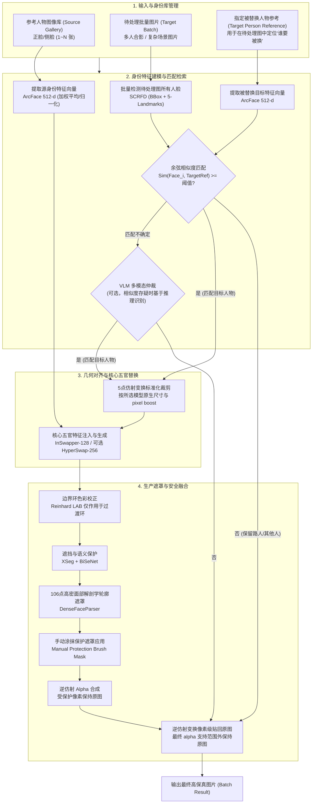

# PersonaWeave 系统架构与详细技术设计方案

> 本文说明功能架构；代码依赖方向、生产/诊断/退役分类及兼容治理以 [docs/engineering-architecture.md](./docs/engineering-architecture.md) 为准。

---

## 一、 系统架构总览

PersonaWeave 采用**局部空间对齐、特征驱动换脸、精细语义遮罩、光影色彩补偿与高分辨率无损贴回**的工业级流水线架构。



---

## 二、 核心技术模块与数学原理设计

### 1. 人脸检测与身份识别（解决“指定人物换，其他人不换”）

#### ① 检测与对齐 (Detection & Alignment)
*   **模型**：`SCRFD-10G-KPS`（`models/buffalo_l/det_10g.onnx`）。
*   **输入**：全尺寸原图 $I_{\text{target}} \in \mathbb{R}^{H \times W \times 3}$。
*   **输出**：检测框 $B_i = [x_{\min}, y_{\min}, x_{\max}, y_{\max}]$，置信度 $s_i$，以及 5 个关键点（双眼、鼻尖、双嘴角） $K_i \in \mathbb{R}^{5 \times 2}$。

#### ② 身份特征向量化与比对 (Identity Embedding & Matching)
*   **模型**：`ArcFace w600k_r50`（`models/buffalo_l/w600k_r50.onnx`）。
*   **算法逻辑**：
    1.  **建立目标检索模版**：输入指定被替换人物的照片，提取 $k$ 个特征向量 $v_1, v_2, \dots, v_k$，计算加权平均中心向量并归一化：
        $$\mathbf{e}_{\text{target}} = \frac{\sum_{j=1}^k w_j v_j}{\|\sum_{j=1}^k w_j v_j\|_2} \in \mathbb{R}^{512}$$
    2.  **建立源注入模版**：同理，从换入人物（Source）的照片中提取标准化特征 $\mathbf{e}_{\text{source}} \in \mathbb{R}^{512}$。
    3.  **余弦距离比对与决策**：
        对于待处理图片中检测到的第 $i$ 个人脸特征 $\mathbf{f}_i$：
        $$\text{CosineSim}(\mathbf{f}_i, \mathbf{e}_{\text{target}}) = \mathbf{f}_i^\top \mathbf{e}_{\text{target}}$$
        *   若 $\text{CosineSim} \ge \tau$（API 与前端当前默认 $\tau = 0.35$，调用方可调）：判定为指定人物，触发换脸。
        *   若 $\text{CosineSim} < \tau$：判定为旁人/路人，跳过处理，直接透传。

---

### 2. 跨图一致性保障机制（解决“多图人物长相统一”）

1. **统一的参考特征集合**：
   * 同一任务复用各参考图已提取的 ArcFace 特征与质量/姿态元数据。`gallery` 模式使用质量加权融合向量；`best-match` 模式可按每张目标脸的偏航比例选择不同参考，因此不能描述为单一源向量在所有图片中绝对冻结。
2. **多视角图库加权融合 (Multi-View Gallery)**：
   * Web Studio 允许每个身份选择最多 8 张多角度参考图。素材库默认按正脸、左右大侧脸、左右低头侧脸与接近 ±30° 视角确定性分层选择，而非随机抽取；后端再按参考质量与目标姿态做加权/最佳匹配。

---

### 3. 高保真还原与色彩光影融合（解决“背景色调不变与自然融合”）

本地换脸路径不使用整图扩散重绘：最终 warped alpha 支持范围以外的像素保持原图，mask 内与边界过渡环允许按换脸、遮挡保护和色彩校正规则变化。可选 AI 精修是另一条整图生成路径，不具备逐像素不变保证。生产本地路径执行以下处理：

#### ① 仿射变换与逆映射 (Affine Transformation & Inverse Warping)
*   根据 5 点标准面部模版计算变换矩阵 $M \in \mathbb{R}^{2 \times 3}$：
    $$I_{\text{crop}} = \text{warpAffine}(I_{\text{target}}, M, (512, 512))$$
*   换脸与增强完成后，利用逆矩阵 $M^{-1}$ 将局部结果精准逆投影回原图画布对应坐标位置。
*   对齐裁剪的插值方式按变换矩阵的实际缩放比例（$\sqrt{|\det M_{2\times2}|}$）动态选择：≤1（缩小）用 `INTER_AREA`，>1（放大）用 `INTER_CUBIC`。此前固定使用 `INTER_AREA`，而 pixel-boost 对中小尺寸人脸恰恰是放大（送入更大的模型输入分辨率），按 OpenCV 官方文档，`INTER_AREA` 用于放大时效果接近 `INTER_NEAREST`，会让换脸模型的输入偏糊。

#### ② 面部遮罩与遮挡物剔除 (Masking & Occlusion Handling)
*   **生产实现**（`swap_single_face_facefusion`，即 API/CLI 实际调用路径）：box mask ∩ 106 点解剖学轮廓 mask ∩ **XSeg 遮挡 mask** ∩ **BiSeNet 语义区域保护 mask** 四者取交集。`core/occluder.py` 的 `FaceOccluder` 加载 `models/xseg_1.onnx`（真实 ONNX 模型推理，非启发式），产出 [0,1] 的"保留"置信度图，用于剔除手部/异物遮挡区域。
*   **语义区域保护**（`core/region_parser.py` 的 `RegionFaceParser`，加载 `models/bisenet_resnet_34.onnx`）：19 类 CelebAMask-HQ 语义分割（`skin/left-eyebrow/right-eyebrow/left-eye/right-eye/glasses/.../nose/mouth/upper-lip/lower-lip/neck/necklace/cloth/hair/hat`），生产路径默认保护 `glasses`（class 6）。XSeg 只能识别"异物遮挡"（手、道具等前景物体），并不知道某块像素在语义上是"眼镜"，因此换脸时眼镜镜框/镜片经常被 InSwapper 融化变形而毫无保护；BiSeNet 补上这一类专属语义保护。模型缺失时优雅降级为 `None`（与 XSeg/106点解析器同一容错模式），不阻断其余 mask。
*   **已退役路径**：旧 `swap_single_face_seamless` 诊断变体及其 YCrCb/局部边缘启发式遮挡回退已退役；生产只使用上述 XSeg + BiSeNet + 106 点保护链路，并在模型不可用时按各组件既有容错方式降级。
*   **遮罩构建策略**：
    *   **正向换脸区域**：106 点关键点构成的面部解剖轮廓。
    *   **反向保护区域**：XSeg 判定为遮挡的连通区域、BiSeNet 判定为 `glasses` 的连通区域，以及手动画笔保护层。
    *   **边缘柔化**：对最终 Mask 的边缘执行高斯核羽化（Gaussian Blur），防止产生明显的拼接硬边缘。XSeg 与 BiSeNet mask 的羽化半径均按裁剪宽度等比缩放（`sigma = max(2, width * 5 / 256)`），此前固定 5px，导致 pixel-boost 到大分辨率的特写比小脸有更硬的遮挡边缘。

> ⚠️ 旧 `swap_single_face_seamless()` 诊断/研究变体已退役，不再视为已实现或受支持路径。以下未接入生产的恢复、全脸迁色与发丝启发式算法只作为历史设计说明；生产路径 `process_image()` / `process_image_multi_mapping()` 仅调用 `swap_single_face_facefusion()`。生产换脸算法的准确、权威描述见 [docs/facefusion-local-swap.md](./docs/facefusion-local-swap.md)。

#### ③ 光影与色温自适应迁移 (Reinhard Color Harmonization in LAB Space) —— 边界环模式已接入生产
新五官可能源自暖色调参考图，而原图可能是背光冷色调。为了消除肤色断层，在 LAB 色彩空间进行均值与标准差对齐：
1. 将原局部人脸 $I_{\text{orig}}$ 与换脸增强后的人脸 $I_{\text{swap}}$ 转至 $L^*a^*b^*$ 空间。
2. 对每个通道 $c \in \{L, a, b\}$：
   $$I_{\text{harmonized}}^c = \left( \frac{I_{\text{swap}}^c - \mu_{\text{swap}}^c}{\sigma_{\text{swap}}^c} \right) \cdot \sigma_{\text{orig}}^c + \mu_{\text{orig}}^c$$
3. 转回 RGB 空间，实现新五官光影色调与原图环境光的物理级契合。

*   **生产实现（边界环模式）**：`swap_single_face_facefusion` 会用 `reinhard_color_transfer(swapped_crop, crop, face_mask=crop_mask)` 计算一次全脸调和结果，但只取 mask 边缘的窄过渡环（`crop_mask` 与其腐蚀版本之差，随裁剪宽度等比羽化）与原始换脸结果混合——脸部本体色调完全不变。该固定生产行为只消除源参考图与目标场景之间的曝光/白平衡拼接缝，不提供全脸迁色或换脸后恢复参数。

#### ④ 面部高清质感增强 (Controllable Facial Restoration) —— 已从换脸路径移除
*   CodeFormer/GFPGAN 全脸修复实现已从当前源码和启动资产中移除；该处理可能改变身份与受保护像素，不得作为生产回退重新接入。


#### ⑤ 106点高密面部解剖学轮廓 (解决"面部轮廓精准裁切") —— 生产已启用
*   **模型**：`buffalo_l/2d106det.onnx` (192×192 input)。
*   提取 106 个特征点：33 点连续下颌线 (index 0-32)、眉弓 (33-52)、鼻梁、嘴唇轮廓。
*   生成像素级解剖学遮罩机制：
    1. 通过 0-32 点构建下颌多边形。
    2. 基于眉毛坐标向上延伸 40% 估算额头弧度。
    3. 计算下颌+额头特征点的凸包 (Convex Hull)。
    4. 应用 31×31 高斯模糊实现无缝边缘羽化。
*   备选方案：若特征点提取失败则降级回退至优化的椭圆遮罩。

#### ⑥ "眼球视线与巩膜协调" —— 代码库中不存在此算法
*   全仓搜索 `gaze`/`sclera` 未发现任何几何/像素级视线矫正实现。该说法目前仅以自然语言形式出现在 AI 精修的 VLM 审核 Prompt 中（作为让 VLM 判断"视线是否自然"的一项检查描述），不是本流水线的图像处理步骤。此前版本文档将其列为已实现能力，属于失实描述，此处予以更正。

#### ⑦ 发丝与刘海保护 (Hair Strand & Bangs Protection) —— 旧启发式已移除
*   基于亮度差与固定上半区的旧启发式不属于生产能力，也不应恢复。生产中的头发/眼镜/遮挡保护必须继续由 106 点解剖学 mask、XSeg、BiSeNet 与手动保护层的交集完成。

#### ⑧ 多模态 VLM 人物识别仲裁 (Multi-Modal VLM Person Identification Arbiter) —— 生产已启用
*   **核心模块**：`core/vlm_arbiter.py`，经由 `core/ai_gateway.py`（`AIGateway`，LiteLLM Router 封装）调用配置在 `config/ai_gateway.yaml` 中的模型别名（如 `personaweave-vision-precision`），不再直接依赖 LiteLLM。
*   在仅靠几何人脸相似度出现歧义时，提供基于 AI 认知推理的人物身份辨别；也用于 `/api/v1/cluster-faces` 的聚类结果语义复核。
*   **返回值**：`core/vlm_contracts.py` 中的 `IdentityArbitration` 契约，包含 `matched_person_index`, `confidence`, `reasoning` 与 `attributes_matched`。

#### ⑨ 换脸模型路由 (SwapperModelRouter) —— 生产已启用
*   **核心模块**：`core/model_router.py`。
*   自动模式默认稳定使用 `inswapper_128`；仅在调用方显式传入 `allow_research_models=true`、人脸尺寸 ≥160、绝对 yaw ≤0.45 且身份置信度 ≥0.55 时自动选择 `hyperswap_1c_256`。`ghost_1_256` 只接受显式模型请求，不进入自动路由；显式 HyperSwap 请求未 opt-in 时降级。
*   返回 `RoutingDecision(requested, selected, reason, fallback)`，记录在 `SwapResult.model_routing` 中供审计。

#### ⑩ 参考图质量评分 (Reference Quality Scoring) —— 生产已启用
*   `calculate_reference_quality()` 综合尺寸(35%)、清晰度(30%，拉普拉斯方差)、检测置信度(20%)、姿态角度(15%) 计算 0~1 分数；`describe_reference_quality()` 映射为 `excellent`/`usable`/`low` 三档，接入 `/api/v1/detect-faces` 响应字段 `quality_score`/`quality_tier`/`quality_notes`。

#### ⑪ AI Gateway 与图像编辑网关 (`core/ai_gateway.py`)
*   配置驱动（`config/ai_gateway.yaml`，路径可由 `PERSONAWEAVE_AI_CONFIG` 覆盖）的统一网关。精确 VLM/图像编辑别名、后端型号、默认项和回退链只在 [docs/model-catalog.md](./docs/model-catalog.md) 与 YAML 中维护；`GET /api/v1/ai/models` 从相同配置动态返回前端可展示的非敏感图像模型信息。
*   所有别名均通过 **DMXAPI**（`https://www.dmxapi.cn/v1`，OpenAI 兼容协议的第三方模型聚合网关）调用；密钥经 `os.environ/NAME` 语法从 `.env` 解析，禁止硬编码。
*   `core/providers/` 下的 DMX 私有协议适配器统一返回 `ImageEditResult(image_bytes, model, provider, usage, request_id)`。
*   `core/vlm_contracts.py` 提供"契约优先"校验：当前契约为 `ReviewIssue`、`FaceReviewReport`、`BatchFaceReview`、`WholeImagePersonAssessment`、`WholeImageQualityReview` 与 `IdentityArbitration`。瑕疵 `category` 使用固定七分类枚举，`region`/`description`/`suggestion` 有具体性约束并与 Prompt few-shot 范例同步维护；不再把已退役的局部候选/整图保护闸门契约列为当前能力。

#### ⑫ 整图 AI 精修（权威设计：[docs/ai-refinement.md](./docs/ai-refinement.md)）
*   精修先对当前 revision 执行人物选择/定位预检，再用一次整图 VLM 调用为所有选中人物组织具体瑕疵清单和简洁的文字可见定位；用户可在生成前补充或修正指令。
*   图像模型只接收当前有瑕疵的完整图像这一张图片，以及人物文字定位、完整瑕疵清单和用户补充。身份参考图、素材库图片、人物裁剪、mask、关键点图、标注图和旧 revision 均不得作为图像输入。
*   provider 返回整图后仅做编码、方向、色彩模式、尺寸和元数据规范化；规范化整图直接作为 staging candidate 保留，不调用 `apply_candidate()`，不做关键点对齐、mask 应用、手动保护或局部合成。
*   候选生成后只执行一次整图 VLM 质量复评，输出目标问题改善、回归和无关变化等提示性证据。复评不构成自动质量闸门，最终接受、重试或取消由用户决定。
*   新任务状态语义为 `QUEUED → REFINING → REVIEWING → REVIEW_REQUIRED → ACCEPTING → ACCEPTED`，另有 `CANCEL_REQUESTED`/`CANCELLED`/`FAILED`。人物定位与诊断发生在创建任务之前；`LOCALIZING` 仅为旧持久化数据兼容状态，新任务不发出。
*   `RefinementTaskManager` 继续负责两阶段落盘（`outputs/refinement_staging/{task_id}/` → `outputs/api_results/refinement/accepted/`）、`expected_revision` + `candidate_digest` 乐观锁、取消/重试/恢复、安全图片加载与原子发布。接受时发布已确认 digest 对应的规范化 staging 字节，不重新生成或合成。
*   所有模型经 `AIGateway` 路由；VLM 使用 `personaweave-vision-*`，图像编辑使用 `personaweave-refine-*`。重试可切换已配置图像模型别名，但不得暗中添加参考图或局部处理。

#### ⑬ 人像素材库 (`api/portrait_library.py` + `api/portrait_library_import.py`)
*   SQLite 存储（`data/portrait_library/library.sqlite3`：`identities` / `assets` / `import_audit` 三表），素材文件分区存放于 `data/portrait_library/{originals,thumbnails,quarantine}/`。
*   对外只暴露不透明 ID（`opaque_id()` = 内容哈希前20位），从不返回真实文件路径，路径解析统一做 `is_relative_to` 防越权校验。
*   `personaweave-import-portraits`（`pyproject.toml` 中的 `[project.scripts]` 入口）是幂等导入 CLI，从 `manifest.csv` 批量导入外部素材，按内容哈希跳过未变化文件，损坏图片自动移入 `quarantine/`。

---

## 三、 模块与代码工程架构

```text
PersonaWeave/
├── pyproject.toml            # uv 项目配置与依赖管理
├── cli.py                    # 命令行离线批处理入口（单目录/单人模式，不含精修/人像库）
├── config/
│   └── ai_gateway.yaml       # AI Gateway 模型别名配置 (VLM + 图像编辑)
├── core/                     # 核心算法与高保真流水线
│   ├── detector.py           # SCRFD-10G 人脸检测与 5 关键点定位
│   ├── face_metrics.py       # Yaw、参考质量、可见变化与侧脸兼容纯规则
│   ├── recognizer.py         # ArcFace w600k_r50 身份特征提取与余弦匹配
│   ├── swapper.py            # InSwapper-128 ONNX 推理封装
│   ├── model_router.py       # SwapperModelRouter：inswapper/hyperswap/ghost 路由
│   ├── occluder.py           # FaceOccluder：XSeg (xseg_1.onnx) 遮挡检测，生产已启用
│   ├── region_parser.py      # RegionFaceParser：BiSeNet (bisenet_resnet_34.onnx) 语义区域保护，生产已启用
│   ├── color_matcher.py      # LAB Reinhard 色温迁移（生产换脸仅使用边界环校正）
│   ├── face_parser.py        # ★ 106点稠密关键点解剖学轮廓遮罩 (DenseFaceParser)
│   ├── ai_gateway.py         # ★ AI Gateway：LiteLLM Router 封装，统一 VLM/图像编辑模型别名
│   ├── vlm_arbiter.py        # ★ 多模态 VLM 智能身份仲裁（经 AIGateway 调用）
│   ├── vlm_contracts.py      # ★ VLM 结构化输出 Pydantic 契约
│   ├── refinement_service.py    # ★ 整图预检/诊断、生成规范化与提示性整图复评服务
│   ├── providers/            # ★ DMXAPI 私有协议适配器 (dmx_seedream.py / dmx_responses.py)
│   └── pipeline.py           # 完整端到端流水线驱动 (PersonaWeavePipeline)
├── api/                      # FastAPI RESTful 服务层
│   ├── app.py                # 路由入口与 Lifespan 模型单例管理
│   ├── schemas.py            # Pydantic 请求/响应数据契约 (含 PersonMappingItem、Refinement*)
│   ├── task_manager.py       # 异步批量换脸任务管理器与 Webhook 回调
│   ├── refinement_task_manager.py  # ★ AI 精修专属异步任务管理器（草稿/正式两阶段落盘）
│   ├── portrait_library.py         # ★ 人像素材库服务 (SQLite)
│   └── portrait_library_import.py  # ★ 幂等素材导入 CLI (personaweave-import-portraits)
├── web/                      # PersonaWeave Web Studio 前端工程 (pnpm)
│   └── src/
│       ├── components/
│       │   ├── ui/           # 对比查看器、Toast、错误边界等共享 UI
│       │   ├── studio/       # 业务组件（基于 Radix UI Primitives 与 Tailwind）
│       │   │   ├── SourceGallery.tsx          # 源身份图库 (5点 Yaw 比例估计)
│       │   │   ├── TargetCanvas.tsx           # ★ 主画布 (选人/卷帘/放大镜/保护笔)
│       │   │   ├── ParameterPanel.tsx         # 算法超参数推子与即时试换
│       │   │   ├── BatchPipelineDrawer.tsx    # 批量流水线监控与 ZIP 导出
│       │   │   ├── MultiPersonMatrixModal.tsx # ★ 多角色人物 1-to-1 映射矩阵
│       │   │   ├── RefinementModal.tsx        # ★ 整图 AI 精修编排交互
│       │   │   ├── RefinementReviewPanels.tsx # 精修纯展示面板
│       │   │   └── PortraitLibraryModal.tsx   # ★ 人像素材库选取
│       │   └── layout/       # AppHeader (GPU 状态/样例载入)
│       ├── hooks/            # 聚类、手动保护画笔等可复用行为
│       ├── stores/           # Zustand 全局状态管理 (useStudioStore)
│       ├── services/         # Axios API 客户端封装 (api.ts)
│       ├── types/            # 共享类型定义
│       └── utils/            # cn.ts、sourceReferences.ts 等工具函数
├── utils/
│   ├── affine.py             # 仿射变换与逆映射、软边缘遮罩
│   └── gpu_helper.py         # NVIDIA CUDA 动态库预加载与 Provider 自适应
├── models/                   # 预训练 ONNX 模型资产 (buffalo_l/, inswapper, xseg_1, bisenet…)
├── tests/                    # 单元测试与端到端集成测试
├── scripts/                  # 质量验证与基准对比脚本
├── data/                     # 测试数据集 + data/portrait_library/ (人像库 SQLite + 素材)
└── outputs/                  # 处理产物输出目录 + outputs/refinement_staging/ (精修候选草稿区)
```

> 项目前端未引入 shadcn/ui 生成式组件工作流；`components/ui/` 是项目自身的共享 UI 边界，业务组件基于 Radix UI Primitives 与 Tailwind 组合。

---

## 四、 RESTful API 接口规范设计

### 1. 提交批量换脸任务

*   **Endpoint**: `POST /api/v1/batch-tasks`
*   **Content-Type**: `application/json`

#### Request Payload:
```json
{
  "person_mappings": [
    {
      "person_index": 1,
      "target_reference_url": "https://storage.example.com/representative_group.jpg",
      "target_reference_person_index": 1,
      "source_manual_images": ["https://storage.example.com/role_a.jpg"],
      "source_mode": "best-match"
    },
    {
      "person_index": 3,
      "target_reference_url": "https://storage.example.com/representative_group.jpg",
      "target_reference_person_index": 3,
      "source_identity_id": "opaque-library-identity-id",
      "source_mode": "best-match"
    }
  ],
  "batch_images": [
    {
      "client_target_id": "party-1",
      "image_url": "https://storage.example.com/party_photo_1.jpg",
      "manual_mask": null
    },
    {
      "client_target_id": "party-2",
      "image_url": "https://storage.example.com/party_photo_2.jpg",
      "manual_mask": null
    }
  ],
  "parameters": {
    "similarity_threshold": 0.38,
    "identity_blend_strength": 0.72,
    "enable_dense_mask": true,
    "source_mode": "best-match"
  },
  "callback_url": "https://api.example.com/webhook/task-completed"
}
```

> **说明**：多角色 `person_mappings` 与单角色的 `source_identity_id` / `source_asset_ids` / `source_manual_images` + `target_reference_url` / `person_index` 是互斥模式，schema 会拒绝混用。批量目标优先使用带稳定 `client_target_id` 和逐图 `manual_mask` 的 `batch_images`；`batch_image_urls` 仅保留为已弃用兼容字段。
>
> **人物-身份分配算法**：`core/pipeline.py` 的 `resolve_person_mapping_assignment()` 用匈牙利算法（`scipy.optimize.linear_sum_assignment`）在全部 `person_mappings` 与检测到的人脸之间求解全局最优一一分配（最大化总相似度），而不是按列表顺序贪心地让每个映射抢占自己的最佳匹配——后者会让排序靠前的映射抢走本该属于后一个映射的更强匹配（例如两个目标身份在合影中都与同一张脸相似度较高时）。低于各自 `similarity_threshold` 的配对会在求解前被屏蔽（设为 -1），并在求解后用真实相似度再校验一次，避免"被迫接受"的无效配对。
>
> ⚠️ 请求示例只展示生产路径实际使用的参数。生产融合固定采用受保护 mask 的 alpha 贴回与边界环色彩校正，不提供 Poisson、换脸后恢复或全脸迁色变体。

#### Response:
```json
{
  "code": 200,
  "message": "Batch task accepted successfully",
  "data": {
    "task_id": "pw_task_8f93e2b10a",
    "total_images": 3,
    "status": "QUEUED",
    "estimated_seconds": 1.55
  }
}
```

### 2. 查询任务状态与结果

*   **Endpoint**: `GET /api/v1/batch-tasks/{task_id}`

#### Response:
```json
{
  "code": 200,
  "data": {
    "task_id": "pw_task_8f93e2b10a",
    "status": "COMPLETED",
    "progress": 1.0,
    "total_images": 3,
    "processed_images": 3,
    "created_at": "2026-08-24T09:00:00Z",
    "completed_at": "2026-08-24T09:00:02Z",
    "results": [
      {
        "original_url": "https://storage.example.com/party_photo_1.jpg",
        "processed_url": "/api/v1/files/pw_task_8f93e2b10a/res_0001.jpg",
        "status": "SUCCESS",
        "faces_detected": 4,
        "faces_swapped": 1,
        "matched_similarities": [0.72],
        "cost_ms": 280
      }
    ]
  }
}
```

### 3. 同步实时单图换脸

*   **Endpoint**: `POST /api/v1/swap-sync`

### 4. 人脸快速检测与姿态分析

*   **Endpoint**: `POST /api/v1/detect-faces`
*   单图检测所有人脸，返回检测框 (BBox)、5 关键点 (KPS)、置信度与由 5 点几何估计的归一化 yaw ratio（不是 3D 头姿角）。

### 5. 跨图人脸身份聚类

*   **Endpoint**: `POST /api/v1/cluster-faces`
*   输入多张图片 URL 列表，基于 ArcFace 余弦相似度进行跨图身份聚类，输出统一的 `global_person_id` 映射表。

### 6. VLM 多模态智能仲裁

*   **Endpoint**: `POST /api/v1/vlm/arbitrate`
*   输入参考人物照片与候选合影，调用视觉大模型做辅助仲裁，返回契约校验后的 `matched_person_index`、`confidence`、`reasoning` 与 `attributes_matched`；最终身份匹配仍以 ArcFace 相似度为准。

### 7. AI 整图精修 (`/api/v1/refinement/*`)

> 下表描述当前契约；若与 [docs/ai-refinement.md](./docs/ai-refinement.md) 冲突，以后者及 `api/schemas.py` 的实际 schema 为准，并必须同步修正文档。

| Endpoint | 用途 |
| :--- | :--- |
| `POST /api/v1/refinement/review` | 对当前整图及全部选中人物执行一次结构化预检诊断，返回每人的具体 issues 与文字可见定位，不生成图。 |
| `POST /api/v1/refinement/tasks` | 在用户补充指令后创建精修任务；图像模型只接收当前有瑕疵整图，provider 规范化整图直接进入 staging，随后执行一次提示性整图 VLM 复评。 |
| `GET /api/v1/refinement/tasks/{task_id}` | 查询任务状态、revision/digest、候选元数据与提示性整图复评。 |
| `POST /api/v1/refinement/tasks/{task_id}/cancel` | 安全取消进行中的任务，产生 `CANCEL_REQUESTED → CANCELLED`，不发布部分产物。 |
| `POST /api/v1/refinement/tasks/{task_id}/accept` | 由用户接受候选；校验 `expected_revision` + `candidate_digest` 后原子发布该 staging 候选，不以 VLM 复评作为强制闸门。 |
| `POST /api/v1/refinement/tasks/{task_id}/people/{person_id}/retry` | 以当前活动 revision 重试并可选择已配置图像模型别名；只有用户明确选择时才基于上一候选继续。 |
| `GET /api/v1/refinement/tasks/{task_id}/candidate` | 返回候选图文件（草稿区 `outputs/refinement_staging/`）。 |

新任务状态机：`QUEUED → REFINING → REVIEWING → REVIEW_REQUIRED → ACCEPTING → ACCEPTED`（另有 `CANCEL_REQUESTED`/`CANCELLED`/`FAILED`）；`LOCALIZING` 只用于读取旧持久化任务。

### 8. 人像素材库 (`/api/v1/portrait-library*`, `/api/v1/portrait-assets/*`)

| Endpoint | 用途 |
| :--- | :--- |
| `GET /api/v1/portrait-library` | 返回按身份分组的素材目录（SQLite `data/portrait_library/library.sqlite3`）。 |
| `GET /api/v1/portrait-assets/{asset_id}/thumbnail` | 缩略图，`asset_id` 为不透明 ID。 |
| `GET /api/v1/portrait-assets/{asset_id}/content` | 原图内容。 |

素材通过 `personaweave-import-portraits` CLI（`api/portrait_library_import.py`）从 `manifest.csv` 幂等导入，详见 README。

### 9. 其他接口

*   `GET /api/v1/ai/models` — 从 AI Gateway 配置返回不含密钥的图像编辑模型目录、默认别名和说明。
*   `GET /api/v1/task-history/batch-tasks?limit=` — 返回有上限的轻量批量任务历史摘要，不包含完整结果或图片 URL；查看时再按 `task_id` 获取详情。旧 `GET /api/v1/batch-tasks` 完整列表仅为兼容性保留。权威契约见 [docs/task-history.md](./docs/task-history.md)。
*   `GET /api/v1/files/{subpath}`、`GET /api/v1/data/{subpath}` — 带路径穿越防护的静态产物/素材文件服务。
*   `GET /api/v1/samples` — 内置示例图清单。
*   `GET /health`、`GET /api/v1/health` — 健康检查，含可用 ONNX Provider 列表与 pipeline 就绪状态。

完整、始终最新的接口定义以运行中的 `GET /docs`（Swagger UI）为准。

---

## 五、 PersonaWeave Web Studio 前端工作台设计方案

PersonaWeave Web Studio 是一套面向专业创作者与批量生产用户的现代化 AI 视觉工作台，集**源身份资产库管理**、**交互式定点人脸选定**、**手动保护画笔**、**多角色映射矩阵**、**双视口前后无缝卷帘对比**以及**批量任务流水线监控**于一体。

任务历史使用服务端持久化摘要作为事实源，浏览器数据只补充本机目标名称和活动任务关联。完成结果在独立只读对话框中按需加载，不回填或覆盖当前编辑工作区；只有仍在运行且具有本机关联的任务允许重新连接。

### 1. 设计哲学与视觉语言 (Visual Aesthetics & Design System)

*   **设计参考标准**：对标 Figma 创作者工具、Linear 极简暗调生产力美学以及 Midjourney / Leonardo 级创意工作流。
*   **配色体系 (Color Palette)**：
    *   **Backgrounds**: 深邃质感暗色（`#09090b` Canvas, `#121215` Panels, `#18181b` Card Elevates）。
    *   **Borders & Glass**: 半透明冷灰边框（`border-white/10`）、高斯背景虚化（`backdrop-blur-xl`）。
    *   **Accent & Focus**: Cyber Indigo (`#6366f1` / `rgba(99, 102, 241, 0.2)`) 与 Neon Cyan (`#06b6d4`)，用于高亮人脸选框与激活态滑块。
*   **动态与交互反馈 (Micro-Interactions)**：
    *   引入 **Framer Motion** 弹簧物理动效（`stiffness: 300, damping: 25`），让侧边栏抽屉展开、模态框弹出和卡片拖拽如丝般顺滑。
    *   **人脸识别扫描线动效 (Face Scanner Effect)**：在图片加载并完成人脸提取时，以霓虹光束轻扫面部区域。
    *   **任务成功发射粒子微光 (Success Celebrations)**：集成 `canvas-confetti` 在批量百图任务处理完成时提供爽快的交互奖励。

---

### 2. 工作台核心功能区域规划 (Workbench Layout)

```text
+----------------------------------------------------------------------------------------------------+
|  [Logo] PersonaWeave Studio     [GPU: RTX 4060 (2.1GB)]  [Production Swap]       [Docs] [⚙️]  |
+---------------------+-------------------------------------------------------+----------------------+
| 1. 源人物身份图库    | 2. 中央主画布与交互选定区 (Interactive Canvas)         | 3. 生产参数面板       |
| (Source Gallery)    |                                                       | (Parameters)         |
|                     | +---------------------------------------------------+ |                      |
| [ + 拖拽上传图片 ]  | | [单图|卷帘|放大镜|🖌️保护笔] [👥多角色矩阵] [🤖VLM] | | · 相似度阈值 (0.38)  |
|                     | +---------------------------------------------------+ |   [====|=========]   |
| · 参考图 #1 (正脸)  | |                                                   | | · 106点解剖遮罩     |
|   [ 0° Yaw | 99% ]  | |       原图展示 / 实时检测高亮人脸选框               | |   [ 开启 √ ]         |
| · 参考图 #2 (微侧)  | |       ┌─────┐       ┌─────┐       ┌─────┐         | | · 手动保护层        |
|   [ 15° Yaw | 97% ] | |       │ #1  │       │ #2★ │       │ #3  │         | |   [ 已应用 ]         |
|                     | |       └─────┘       └─────┘       └─────┘         | | · 边界环校正        |
| [融合策略: 动态姿态] | |                   [已指定替换: #2]                 | |   [ 固定启用 ]       |
|   (●) Dynamic Match | |                                                   | | · 106点解剖遮罩     |
|   (○) Mean Gallery  | +---------------------------------------------------+ |   [ 开启 √ ]         |
|                     | 待处理批量图库 (Filmstrip) [Img 01] [Img 02] [Img 03] | · 边缘羽化半径 (5px) |
+---------------------+-------------------------------------------------------+----------------------+
| 4. 批量处理流水线与导出中心 (Batch Pipeline Hub)                                                    |
| 任务 ID: pw_task_8f93  | 进度: [====================================> 85%] 17/20 张  | 耗时: 4.8s    |
| [ ▶ 开始批量换脸 ]     | [ 💾 一键打包下载全部结果 (ZIP) ]    [ 🔍 展开任务明细抽屉 ]                |
+----------------------------------------------------------------------------------------------------+
```

#### ① 源人物身份图库面板 (Source Gallery Panel)
*   支持拖拽上传 1~N 张多角度的高清源人脸。
*   前端自动调用后端快速预检测，展示提取出的 5 点对齐小头像，并把归一化 yaw ratio 映射为便于阅读的近似左右朝向标签；该标签不是 3D 头姿测量。
*   提供融合策略开关（动态姿态匹配 `best-match` 或多图加权平均 `gallery`）。

#### ② 中央主视口与交互标注区 (Interactive Canvas & Face Picker)
*   **交互式人脸指定**：自动在画布上叠加 SVG/Canvas 渲染的高精度面部半透明识别框，用户直接在画面上点击即可指定"谁要被换"，或使用快捷序号切换（#1 ~ #5）。
*   **前后无缝卷帘对比 (Split Slider)**：拖动垂直中轴线，左侧实时显示换脸后效果，右侧显示原始底图，直观检查发丝、光影与背景一致性。
*   **像素级质感放大镜 (300% Magnifier)**：悬浮鼠标即可开启 300% 局部微观视口，精确质检毛孔、眼球高光与皮肤边缘无缝羽化。
*   **🖌️ 手动保护画笔 (Manual Protection Brush)**：在画布上直接涂抹不允许被换脸的保护区域（如珠宝首饰、眼镜脚、胎记、头饰等），支持画笔/橡皮擦切换与 10~60px 粗细调节，涂抹区域 100% 保留原图像素。
*   **👥 多角色映射矩阵 (Multi-Person Matrix)**：弹出模态框自动展示合影中检测到的所有人物（#1, #2, #3...），用户可为每位人物分别绑定不同源身份图库，一键执行多角色并行替换。
*   **🤖 VLM AI 大模型纠错**：调用视觉大语言模型进行智能身份辅助判断，弹出置信度与推理细节 Banner。
*   **跨图全局人物 ID 聚类**：自动调用 `cluster-faces` 分配统一的全局人物编号（`🎯 #1 目标` / `👤 #2`）。

#### ③ 生产参数控制台 (Production Parameters)
*   **相似度阈值滑块**：实时设定余弦距离判定门槛（0.20~0.80）。
*   **106 点解剖学遮罩**：生产默认启用 DenseFaceParser 高精度轮廓遮罩。
*   **手动保护画笔**：提交额外不可修改区域；白色保护像素在贴回前从换脸 mask 中扣除。
*   **边界环色彩校正**：作为生产融合固定步骤，仅作用于 mask 过渡环。

#### ④ 批量处理流水线与导出监控 (Batch Pipeline & Export Hub)
*   批量待处理图片胶片滚动栏（Filmstrip Carousel），支持增删与状态标注。
*   基于 TanStack Query 轮询状态的流畅进度条、单张平均耗时统计。
*   任务完成时触发 `canvas-confetti` 粒子庆祝特效。
*   支持 `JSZip` + `file-saver` 一键打包下载全部高清结果（ZIP）。

---

### 3. 前端技术栈与架构规范 (`pnpm`)

| 层次 / 维度 | 选用技术 / 库 | 选用理由 |
| :--- | :--- | :--- |
| **包管理工具** | **`pnpm`** | 严格依赖隔离、极速安装、零幽灵依赖、磁盘空间硬链接优化 |
| **构建与核心框架** | **Vite 6 + React 19 + TypeScript 5** | 秒级热更新 (HMR)、类型安全、最新 React 并发特性 |
| **UI 原子组件** | **Radix UI Primitives**（未引入 shadcn/ui 生成式工作流，业务组件直接手写 Tailwind 样式） | 干净无冗余、高度可定制无头组件，无多余运行时负担 |
| **CSS 样式体系** | **Tailwind CSS + Lucide React 图标** | 极具生产力的原子化样式与现代矢量图标库 |
| **动画引擎** | **Framer Motion + Canvas Confetti** | 声明式弹簧物理动效、手势拖拽支持与任务完成粒子特效 |
| **状态管理** | **Zustand** | 极简、扁平、无样板代码的全局客户端状态控制 |
| **服务端通信** | **TanStack Query (React Query) + Axios** | 自动状态缓存、请求去重、失败重试与优雅异步任务轮询 |

---

## 六、 硬件与执行后端

`utils/gpu_helper.py::get_optimal_providers()` 当前只配置 ONNX Runtime 的 `CUDAExecutionProvider` 和 `CPUExecutionProvider`：CUDA 可用时优先使用，否则回退 CPU。代码没有配置 TensorRT Execution Provider，因此不能把 TensorRT 吞吐或显存数字列为现行能力。

仓库目前没有按 GPU 型号、图片分辨率、人数和所选 swapper 分层的可重复性能基准，故不承诺固定张/秒或常驻显存。部署容量应使用实际生产图片集运行基准后决定，并同时记录模型、Provider、硬件、分辨率和人脸数量。

---

## 七、 实施与推进路线图 (Roadmap)

1. **Phase 1: 核心算法与离线 CLI 实现** ✅ (已完成，生产路径已启用)
   * 实现 SCRFD + ArcFace 的特征库构建与余弦距离筛选。
   * 实现 InSwapper 换脸 + 106点解剖学 mask + XSeg 遮挡 mask + 仿射逆贴回（alpha 合成）管线。
   * 编写离线批量处理脚本，验证人脸识别准确率与融合效果。
   * 🗑️ 旧 CodeFormer/GFPGAN 换脸后全脸修复、全脸 LAB 迁色与诊断合成变体已退役；生产仅保留安全的边界环校正。

2. **Phase 2: FastAPI 服务化与异步任务管理** ✅ (已完成)
   * 封装 RESTful API、Pydantic 请求与响应数据契约。
   * 异步批处理任务管理器、状态追踪、进度计算与 Webhook 回调通知。
   * 编写 API 集成测试套件与自动化质量校验。

3. **Phase 3: PersonaWeave Web Studio 前端工作台开发** ✅ (已完成)
   * 使用 `pnpm` 初始化 Vite + React + TypeScript + Tailwind + Radix UI Primitives 工程（实际未引入 shadcn/ui）。
   * 实现源人物身份库、主画布人脸交互选定器、双图卷帘对比器与参数面板。
   * 联调前后端批量换脸任务、实时进度轮询与 Zip 导出。

4. **Phase 3.5: 第一梯队高级增强功能**
   * ✅ 106 点稠密面部解剖学轮廓遮罩 (DenseFaceParser)——生产已启用。
   * ✅ 画布交互式手动保护画笔 (Manual Protection Brush)——生产已启用。
   * ✅ 合影多角色一键映射矩阵 (Multi-Person Matrix Mapping)——生产已启用。
   * ✅ VLM 多模态智能仲裁器 (VLM Arbiter)——生产已启用，现经 AI Gateway 调用。
   * 🗑️ 旧额头发丝与刘海亮度启发式已退役；生产保护由解剖学/XSeg/BiSeNet/手动 mask 共同承担。
   * ❌ "眼球视线与巩膜聚焦矫正"——代码库中不存在此算法，此前文档描述失实，已在"二、3⑥"节更正。

5. **Phase 3.6: AI Gateway 与 AI 精修/人像库能力** ✅ (已完成，本次调研新纳入文档)
   * AI Gateway：配置驱动的 LiteLLM Router 封装，经 DMXAPI 统一调用 VLM 与图像编辑模型（`core/ai_gateway.py`）。
   * 整图 AI 精修任务系统：人物选择/定位预检、一次整图 VLM 诊断、用户补充、当前整图单图生成、整图结果直接 staging、一次提示性整图 VLM 复评、人工接受、乐观锁与原子发布（权威设计见 `docs/ai-refinement.md`）。
   * 人像素材库：SQLite 存储 + 幂等导入 CLI（`api/portrait_library.py` / `api/portrait_library_import.py`）。
   * 换脸模型路由 SwapperModelRouter、参考图质量评分、跨图聚类的 VLM 语义精修。

6. **Phase 3.7: 代码审查修复批次** ✅ (已完成)
   * **AI 精修架构重设计**：废除 `apply_candidate()`、关键点重新配准、mask/手动保护及局部合成作为精修候选必经步骤；provider 规范化整图直接保留，整图 VLM 复评改为提示性信息，由用户决定接受。
   * 生成输入收敛为当前有瑕疵的整图这一张图片与文字人物定位/瑕疵/用户补充，明确禁止身份参考图和人物裁剪；保留 staging、revision/digest、取消/重试/恢复、安全加载与原子发布。
   * 本地换脸：pixel-boost 场景动态选择插值方式（放大用 `INTER_CUBIC`）、XSeg 遮挡羽化按分辨率缩放、多角色映射改为匈牙利算法全局最优分配（`resolve_person_mapping_assignment`）、边界环 Reinhard 色彩校正接入生产路径。
   * `httpx` 从 dev 依赖组移入正式依赖（生产代码 `core/ai_gateway.py`/`core/providers/*.py` 依赖它）。
   * **新增 BiSeNet 语义区域保护**（`core/region_parser.py` + `models/bisenet_resnet_34.onnx`）：此前 `models/bisenet_resnet_34.onnx`/`face_parser.onnx` 是 15 字节的失败下载残留（`Entry not found` 错误页文本，非有效 ONNX），`scripts/download_models.py` 里也从未收录它们；经核实 FaceFusion 官方模型仓库（`facefusion/models-3.0.0`）确有此文件、且与占位符文件名完全一致，已重新下载（SHA-256 `4a0b8c958a3c938913bd06a8365dbb3c8761afba6ecbf0d14b3b1f77eb230c96`，与下载响应头 `x-linked-etag` 完全一致）并纳入默认下载脚本。19 类语义分割，生产路径默认保护 `glasses` 区域，弥补 XSeg 无法识别"这是眼镜"这一语义类别的空白。`face_parser.onnx` 占位符在 FaceFusion 模型仓库中找不到任何对应资产，已删除。

7. **Phase 4: 极致性能加速与生产部署 (TensorRT & Docker)** ⏳
   * 模型导出与 TensorRT FP16 / INT8 量化编译。
   * 引入多进程并发 Worker 架构与全栈一体化 Docker 镜像打包交付。
   * 已退役的全脸修复、全脸迁色、Poisson 合成和发丝启发式不在路线图中，不得绕过生产保护约束重新接入。
