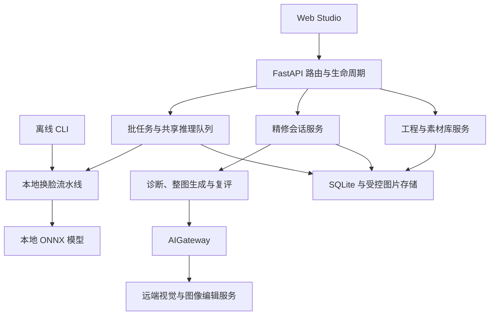

# PersonaWeave 项目综合交接说明

本文面向接手开发、部署和维护的人员，是项目的统一阅读入口。运行操作见 [运行维护手册](operations-runbook.md)，领域细节链接到各自权威文档，不在这里复制接口字段、模型目录或状态机。本次编写的源码基线、工作区范围与检查结果见 [交接文档核对记录](validation/20261014-project-handover.md)；交付安装的版本与验收结果须另外记录。

## 1. 项目定位与交付边界

PersonaWeave 是批量图片定点换脸工作台：准备源人物的多张参考图，选择目标图片中的人物，执行本地换脸，再按人工意图进行可选的整图 AI 精修。主要入口为 Web Studio、HTTP API、离线 CLI 和 Windows 便携版；生产代码入口见 [应用装配](../api/app.py)、[CLI](../api/cli.py)、[便携入口](../api/portable.py)。

| 能力 | 接手时要理解的边界 | 权威说明 |
| --- | --- | --- |
| 单图试换与批处理 | 本地 ONNX 推理；逐图保留结果和失败原因，成功执行不等于身份、自然度合格 | [本地换脸](facefusion-local-swap.md) |
| 多人物与跨图匹配 | 人物映射使用稳定编号、显式参考与全局分配；未知对应保持未知 | [本地换脸](facefusion-local-swap.md) |
| 人像素材管理 | 托管人物/素材按 ID 引用；素材库是独立数据资产，源码安装不附带完整人物库 | [素材库](portrait-library.md) |
| 对话式精修 | 一轮最多生成一张整图候选，复评提供建议，最终发布由人接受 | [精修契约](ai-refinement.md) |
| 工程保存与恢复 | 保存编辑上下文；查看历史与恢复工程是不同动作 | [工程契约](studio-projects.md) |
| 任务历史与导出 | 服务端保存执行记录；当前工程最终导出与原批任务结果各有语义 | [任务历史](task-history.md)、[精修工作台](refinement-workbench.md) |

本项目以图片工作流为交付对象；本说明没有视频处理、实时摄像头、分布式任务集群或多租户运营的验收声明。可选 AI 依赖远端视觉/图像编辑服务并可能产生费用；本地换脸执行不依赖这些凭据，但多图准备的跨图聚类可能触发视觉仲裁，关闭后置精修不代表全流程零远端调用。服务端没有应用登录隔离，访问与费用边界见 [运行维护手册](operations-runbook.md#访问与进程边界)及其 [AI 调用说明](operations-runbook.md#ai-配置与调用费用)。

## 2. 接手阅读顺序

1. 阅读本文，理解两条处理链、领域对象与责任边界。
2. 阅读 [README](../README.md)，选择源码、容器或 Windows 的运行方式；按 [维护手册](operations-runbook.md)登记实例与数据位置。
3. 阅读 [架构概述](../DESIGN.md)、[工程架构](engineering-architecture.md)，从入口追踪到准备修改的功能域。
4. 阅读该功能的权威文档与对应测试；涉及选择原因时再查 [.agents/notes](../.agents/notes/README.md)。
5. 完成本文末尾的接手验收，在独立记录中保存实际结果与剩余问题。

[AGENTS.md](../AGENTS.md) 是跨模块开发规则，[文档治理](documentation-governance.md)规定事实、决策与实测记录的归属。[CHANGELOG](../CHANGELOG.md)仅用于查阅变更历史，不能替代当前实现。历史文档、旧记忆或离线实验与生产入口冲突时，以当前契约和可复现行为核对。

## 3. 技术栈与运行形态

| 层 | 技术与作用 | 版本/配置来源 |
| --- | --- | --- |
| Python 服务 | Python 3.11+、FastAPI/Pydantic、uvicorn；uv 管理环境 | [pyproject.toml](../pyproject.toml)、[uv.lock](../uv.lock) |
| 本地视觉算法 | InsightFace、ONNX Runtime、NumPy、OpenCV、SciPy；检测、特征、推理、掩码与合成 | [流水线](../core/pipeline.py)、[模型资产](../models/README.md) |
| 可选远端 AI | LiteLLM Router，经统一 AIGateway 调用视觉及图像编辑 endpoint | [网关配置](../config/ai_gateway.yaml)、[模型目录](model-catalog.md) |
| Web Studio | React/TypeScript/Vite、Zustand、TanStack Query、Radix、Tailwind、Framer Motion | [package.json](../web/package.json)、[pnpm-lock.yaml](../web/pnpm-lock.yaml) |
| 持久化 | SQLite 元数据、磁盘图片、SHA-256 内容摘要 | [维护手册的数据清单](operations-runbook.md#持久数据与资产清单) |
| 质量工具 | pytest、Ruff、Vitest、Prettier、TypeScript、浏览器诊断脚本 | [CI](../.github/workflows/ci.yml)、[工程架构](engineering-architecture.md) |

依赖清单表示版本约束，锁文件表示解析版本；安装时沿用锁文件，不手抄一份依赖版本表。源码开发/CI 以 Python 3.11 为基准，声明下限不表示任意新版本都适配锁内 runtime wheel。源码开发锁面向 Linux/CUDA；CPU 容器与 Windows 便携构建各有固定 runtime 策略，不能用同一条安装命令假定所有平台兼容。

| 运行形态 | 入口与页面 | 使用场景 |
| --- | --- | --- |
| 源码开发 | `uv run python scripts/dev.py`；前端 3000、API 8000 | 修改前后端；Vite 代理 `/api` |
| Docker | FastAPI 同源提供构建前端和 API，默认宿主端口 8000 | 内部部署；CPU/ARM64 与 CUDA 构建区别见 [Docker 部署](docker-deployment.md) |
| Windows 便携 | 包内 `Start.cmd`，实际地址由启动器显示 | CPU 或 NVIDIA GPU 交付；见 [Windows 指南](windows-portable.md) |
| 离线 CLI | `uv run personaweave --help` | 脚本化本地图片处理；参数以帮助与 [源码](../api/cli.py)为准 |

快速启动命令在 [README](../README.md#本地启动)，实例检查、停机和更新在 [维护手册](operations-runbook.md)。开发环境建议对齐 CI 的 Node 22 与 pnpm 10；它们是仓库工作流使用的版本，不是所有更高版本的兼容性认证。

## 4. 代码地图与改动落点

依赖方向为 `web/src → api → core → provider/runtime`；`core` 不导入 `api`。完整拆分原则与包边界见 [工程架构](engineering-architecture.md)。

| 改动类型 | 优先阅读/修改入口 | 验证重点 |
| --- | --- | --- |
| HTTP 路由、生命周期、静态站点 | [app.py](../api/app.py)、[lifecycle.py](../api/lifecycle.py)、[routes](../api/routes/) | 初始化、降级、异常响应与路由先于静态挂载 |
| 请求与响应 | [通用 schema](../api/schemas.py)、[精修 HTTP 契约](../api/refinement/contracts.py) | 跨字段互斥、非法输入、调用方兼容 |
| 本地换脸与人物分配 | [pipeline.py](../core/pipeline.py)、[model_router.py](../core/model_router.py)、[swapper.py](../core/swapper.py) | 分配、模型路由、掩码、回贴与失败诊断 |
| 批任务与历史 | [batch.py](../api/tasks/batch.py)、[persistence.py](../api/tasks/persistence.py)、[历史功能](../web/src/features/history/) | 摘要/详情、逐图结果、重启、终态删除 |
| AI 路由与配置 | [core/ai](../core/ai/)、[网关 YAML](../config/ai_gateway.yaml) | 配置失败、结构化输出、重试/费用边界 |
| 对话精修 | [会话 service](../api/refinement/service.py)、[store](../api/refinement/store.py)、[conversation](../core/refinement/conversation.py) | 基图、幂等、revision、候选保留与按字节接受 |
| 工程保存与恢复 | [projects](../api/projects/)、[前端 projects](../web/src/features/projects/) | 媒体摘要、冲突、恢复原子性与无模型副作用 |
| 素材库与导入 | [portraits](../api/portraits/)、[importer](../api/portraits/importer.py) | 稳定 ID、manifest、去重、归档与路径边界 |
| 准备工作台 | [App](../web/src/App.tsx)、[studio 组件](../web/src/components/studio/)、[useBatchPipeline](../web/src/hooks/useBatchPipeline.ts) | 单控制器、人物映射、处理中锁定和导出 |
| 精修界面 | [refinement 功能](../web/src/features/refinement/) | 查看/基图/接受独立、诊断确认、SSE 重连 |
| 构建与交付 | [Dockerfile](../Dockerfile)、[Windows 构建器](../scripts/build_windows_portable.py) | 运行时隔离、资产摘要、暂存发布与用户数据保护 |

共享图片加载在 [api/media.py](../api/media.py)，本地 Unicode 路径编解码在 [utils/image_io.py](../utils/image_io.py)。跨功能复用先检查这些边界，避免让业务服务互相反向依赖。`scripts/`同时包含运行工具与非生产诊断，具体脚本用途应从入口、帮助和对应文档确认，不能把实验适配器接成备用生产路径。

## 5. 必须掌握的领域对象

| 对象 | 含义与关系 | 权威来源 |
| --- | --- | --- |
| 源人物与参考素材 | 期望换入的身份；引用托管 identity/asset ID 或明确手动参考 | [素材库](portrait-library.md)、[通用 schema](../api/schemas.py) |
| 目标人物与映射 | 目标图中被替换的位置及跨图身份关联；编号从 1 起，映射必须明确 | [本地换脸](facefusion-local-swap.md) |
| 批任务 | 一次持久化请求及逐图执行结果；不是编辑工程的实时状态 | [任务历史](task-history.md) |
| 编辑工程 | 可变的工作台输入、映射、参数、画笔、结果副本与轻量精修选择 | [工程契约](studio-projects.md) |
| 精修 session | 冻结原图、初稿、稳定人物绑定与实际参考的独立聚合 | [精修契约](ai-refinement.md) |
| 精修 turn | 一次显式基图与 mode 的用户请求及其诊断/生成/复评记录 | [精修契约](ai-refinement.md) |
| 精修 version | 不可变完整图片版本，有父版本和 digest；可从保留的旧版本分支 | [精修接口与存储](refinement-session-api.md) |
| 接受版本 | 人工发布指针，可选会话内保留的初稿或候选；独立于查看版、生成基图与轮次执行状态 | [精修工作台](refinement-workbench.md) |

Zustand 管理编辑工作区，TanStack Query 管理远程读取与缓存；服务器 SQLite 管理任务、工程保存和接受事实。浏览器关联用于识别当前工作区的任务，不用于改写服务端进度。HTTP 契约查运行中的 `/docs` 与 Pydantic schema，模型角色与生成能力查网关 YAML；不要另建前端字段或模型能力清单。

## 6. 端到端业务流程

### 本地处理

1. 上传目标图，准备素材库人物或手动参考图，完成检测与参考特征提取。
2. 在目标画布快速指派人物，必要时使用映射矩阵；确认跨图参考和实际被替换的人物。
3. 单图试换只走本地链；批任务保存请求、排队执行，逐张加载、换脸、保存、释放图片。
4. 流水线完成检测、ArcFace 匹配、全局一一分配、仿射对齐、模型推理、保护掩码求交、边界校色和回贴。
5. 界面展示逐图/逐人物结果，人工核对身份、遮挡和自然度；查看历史、恢复工程或下载按各自入口执行。

生产人物分配使用 [resolve_person_mapping_assignment](../core/face_assignment.py)的全局优化，经阈值屏蔽和真实相似度复核；手动保护画笔作用于本地回贴，不是 AI 精修的输入。算法细节与模型许可不在这里展开，见 [本地换脸契约](facefusion-local-swap.md)。

### 可选 AI 精修

1. 从当前本地结果创建 session，冻结原图、初稿和执行时人物参考；创建本身不调用模型。
2. 用户查看分析、确认该基图的诊断，再补充意见；后端校验诊断与同会话、同基图的绑定。
3. `discuss`仅讨论；`generate`执行显式请求；批任务的 `auto`仅在用户授权且计划可执行时尝试首轮。完整模式语义见 [精修契约](ai-refinement.md)。
4. 诊断/复评使用场景、当前图及身份参考证据；图像生成仅收到选定的完整基图和文字，最多一次图像编辑调用。
5. 候选规范化后整图保存，不本地拼接或 mask 回填；复评失败仍保留候选并记录错误。
6. 人工对比后明确接受，或显式选择基图继续新轮次；接受校验 revision、归属与摘要，发布已校验的同一字节。

原图锚定姿态、人数、遮挡和场景，不锚定期望身份。VLM 建议不是身份真值，不设自动接受分数门槛；整图编辑可能改变背景或小细节，保护文字不是像素不变保证。证据与提示词边界见 [分析](refinement-analysis.md)、[生成](refinement-generation.md)、[提示词](refinement-prompts.md)。

### 保存、查看、恢复与删除

工程自动保存成功才形成服务端持久快照；未上传的草稿不在崩溃恢复保证内。历史查看只读；“恢复工程”校验全部媒体后更新编辑器，不重新检测人物、执行换脸、发出 AI 请求或接受版本。批任务、精修 session 和工程分别拥有数据；删除一种记录不能被当作清空整个安装目录。具体删除范围见 [任务历史](task-history.md)、[工程契约](studio-projects.md)、[精修存储](refinement-session-api.md)。

## 7. 易误改的工程约束

| 约束 | 交接后应避免的误改 | 依据 |
| --- | --- | --- |
| 本地并发 | 将环境变量调大或直接增加 uvicorn workers；共享流水线只允许一个槽位，服务不是分布式租约 | [inference_limiter](../api/inference_limiter.py)、[精修存储](refinement-session-api.md) |
| 身份映射 | 改成逐个贪心分配，或按候选重新检测排序覆盖稳定人物 ID | [本地换脸](facefusion-local-swap.md)、[精修契约](ai-refinement.md) |
| AI 调用 | 绕过 AIGateway、自建供应商 HTTP 回退、按模型名猜能力或加入隐式付费重试 | [模型目录](model-catalog.md) |
| 接受与恢复 | 让模型自动接受，重连自动生成，或工程快照覆盖 accepted 指针 | [精修契约](ai-refinement.md)、[工程契约](studio-projects.md) |
| 本地融合 | 用全脸色彩迁移替代边界环，去掉遮罩交集，或用修复模型重解释保护区域 | [本地换脸](facefusion-local-swap.md) |
| 素材与图片 | 用文件扫描替代 SQLite，暴露真实路径，凭文件名绕过目录/摘要校验 | [素材库](portrait-library.md)、[精修存储](refinement-session-api.md) |
| 质量声明 | 把可见变化、测试通过、Provider 可见或 AI 就绪当成画质/GPU/上游服务验收 | [评测说明](swap-benchmarks.md)、[Windows 指南](windows-portable.md) |

取消等待与原生线程结束不同；AI 请求发出后的取消也不保证免费。重启按持久数据恢复中断状态，不自动补发付费操作；候选与本地成功产物的保留规则见所属专题。队列、内存及真实 Provider 的排查入口见 [维护手册](operations-runbook.md#故障排查)。

## 8. 开发与验证交接

所有 Python 操作经 uv，前端经 pnpm。改动前记录 Git 状态，保护未提交文件；改动后按实际影响选择检查，不把文档改动的检查声称为产品回归。

| 变更范围 | 检查入口 | 证明什么 |
| --- | --- | --- |
| 纯文档 | `uv run pytest tests/test_documentation_consistency.py tests/test_documentation_governance.py` | 链接、长度、分层和受约束的重复事实 |
| Python 实现 | Ruff format/check + 相关 pytest；跨模块变更执行全量 pytest | 格式、静态问题、被断言的业务行为 |
| 前端 | format、lint、test、build，命令见 [README](../README.md#开发与验证) | 格式、类型、组件行为及生产产物可构建 |
| 包边界 | [test_package_boundaries.py](../tests/test_package_boundaries.py) | 入口副作用、单向依赖与图片 I/O 边界 |
| 本地算法 | [换脸回归](../tests/test_facefusion_pipeline.py)、[多人分配](../tests/test_multi_person_assignment.py)、真实样本审阅 | 推理与合成行为；质量仍需独立验收 |
| 会话与恢复 | [session 回归](../tests/test_refinement_sessions.py)、[工程回归](../tests/test_projects.py)、[重启回归](../tests/test_task_restart_persistence.py) | 幂等、冲突、发布、数据保留与重启 |
| Windows/容器 | 各部署指南中的目标平台实测 | 安装、实际模型后端、重启、结果下载，不是跨机器外推 |

后端全量测试含真实模型/图片相关用例，应先按 [模型说明](../models/README.md)准备资产。[CI](../.github/workflows/ci.yml)定义自动检查步骤，但本地完整交付仍包括前端 lint；CI 配置存在本身不代表某个提交或新机器已通过。外部 AI mock、浏览器模拟和真实付费模型验证须分别标注。

固定图片使用 [tests/fixtures](../tests/fixtures/README.md)。全套 API 测试可能初始化默认工程库并写入结果目录，接任验收在独立工作副本进行，不对正在使用的实例全量测试。浏览器诊断脚本见 [工程架构](engineering-architecture.md#界面交互与可视验证)，不使用实际用户数据替换夹具。仅本地验收按 [费用边界](operations-runbook.md#ai-配置与调用费用)隔离远端服务；真实 AI 验证另行明确费用、输入、实际调用次数和候选质量。

## 9. 已知限制与待落实项

| 事项 | 可交接的结论 | 后续责任 |
| --- | --- | --- |
| 换脸与精修画质 | 有样本实测，不保证所有人物、遮挡、姿态的身份迁移或自然度；真实精修记录含未定稿候选 | 用目标业务样本定验收标准，见 [评测](swap-benchmarks.md)、[精修实测](refinement-live-test-20260911.md) |
| 最低硬件与吞吐 | 缺少受限最低容量验收；源码里的预算与超时不是性能 SLA | 在目标机器测量，见 [内存与排队](memory-scheduling.md) |
| 远端 AI 可用性与费用 | 配置就绪和离线测试不验证目标账号、额度、endpoint 或价格 | 接任方登记服务归属、费用上限与测试权限，凭据单独交接 |
| 多用户与横向扩展 | 无应用登录隔离，共享模型/恢复按单进程设计 | 需求变化需单独设计访问控制、租约和隔离，不靠增加 workers 实现 |
| 数据恢复目标 | 源码没有自动备份/跨库一致性恢复承诺；备份与保留依赖实例运维 | 指定备份责任人、频率、保存期限、恢复时间目标，执行 [恢复演练](operations-runbook.md#恢复与迁移) |
| 发行许可 | 模型与依赖各有约束；顶层源码许可不能从包作者字段推定 | 对外分发前确认源码授权、模型条款及素材使用范围，见 [模型说明](../models/README.md) |
| 交付版本与运行资产 | 源码版本不等于安装包/镜像/权重/数据版本，Git 不包含全部运行资产 | 完成 [实例登记](operations-runbook.md#实例登记与启动检查)，保存摘要和交付清单 |
| 人员与外部资源 | 仓库未提供接任人、维护联系人、部署账号、备份保管人与服务账号归属清单 | 移交方和接任方在内部交接记录中落实，不填虚构联系人 |

这些是验收和责任缺口，不是已排期的开发路线图。下一项工作以实际目标、已有决策和验证证据确定，不能将历史计划直接标成待开发或已完成。

## 10. 接手验收清单

在目标部署副本执行；旧实例的运行数据和凭据保持独立。每项记录日期、版本、输入、结果和执行人，未执行项保持未验收。

- [ ] 移交源码版本、未提交补丁、锁文件、安装包/镜像标识与校验和，核实所需模型摘要。
- [ ] 确认数据根目录、完整素材库与结果文件、独立 AI 配置、目录读写权限和访问范围。
- [ ] 按所选平台启动，核对页面、API 文档、`pipeline_ready`和各模型实际 Provider。
- [ ] 用固定参考/目标完成单图与批量本地换脸，检查人物分配、失败诊断、保护画笔和结果下载。
- [ ] 保存工程并刷新/重启，验证人物映射、参数、媒体、画笔和草稿恢复；查看历史不覆盖当前编辑。
- [ ] 若移交 AI 能力，单独确认费用后验证讨论、确认诊断、单次候选、复评失败保留及人工接受；若只移交本地能力，记录 AI 未验收。
- [ ] 下载接受版本并核对字节；区分原批结果与当前工程最终导出，确认历史和工程关联。
- [ ] 完成同批数据库与文件的备份，在隔离副本恢复并实际打开工程、历史和图片。
- [ ] 运行改动对应检查，保留失败及未执行项；明确支持联系人、数据保留、升级与回滚责任。

验收使用的数据只清理本次创建的 ID；交接通过以实际签收记录为准，不由本文存在或单次测试通过推定。
