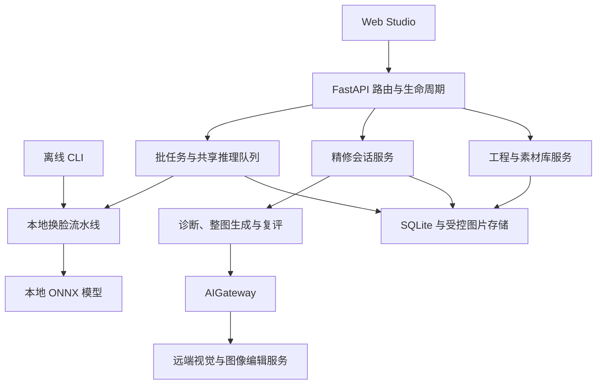

# PersonaWeave 项目综合交接说明

接手先确认交付版本、运行方式、数据位置与责任人，再在独立副本完成末尾的验收清单。前提是取得匹配的程序、模型、数据和受控配置，不能只拿源码启动空实例来签收。缺少资产、凭据归属或恢复证据时，逐项记为未验收。

本文提供产品与代码地图，运行操作见 [维护手册](operations-runbook.md)。领域细节链接到权威文档，不复制接口、模型目录或状态机。源码基线与检查范围见 [交接文档核对记录](validation/20261014-project-handover.md)；目标安装的版本与验收结果单独记录。

## 1. 项目定位与交付边界

PersonaWeave 是批量图片定点换脸工作台：准备源人物参考，明确目标人物映射，执行本地换脸，再按人工意图选择整图 AI 精修。入口包括 Web Studio、HTTP API、离线 CLI 和 Windows 便携版，见 [应用装配](../api/app.py)、[CLI](../api/cli.py)、[便携入口](../api/portable.py)。

- **本地处理**：单图试换与批处理使用 ONNX 推理，保留逐图结果和失败原因。多人映射使用稳定编号、显式参考与全局分配，未知对应保持未知。成功执行不等于身份、自然度合格，见 [本地换脸](facefusion-local-swap.md)。
- **人物资产**：素材按托管 identity/asset ID 引用。素材库是独立数据资产，源码安装不附带完整人物库，见 [素材库](portrait-library.md)。
- **可选精修**：每轮最多生成一张整图候选，复评仅给建议，发布由人接受，见 [精修契约](ai-refinement.md)。
- **保存与回看**：工程保存编辑上下文，历史保存执行记录。查看历史、恢复工程、导出原批结果与当前工程最终结果各有语义，见 [工程契约](studio-projects.md)、[任务历史](task-history.md)、[精修工作台](refinement-workbench.md)。

交付对象是图片工作流。本文不声明视频、实时摄像头、分布式集群或多租户运营通过验收。

本地换脸不依赖 AI 凭据，但多图准备可能触发付费视觉仲裁；关闭后置精修不等于全流程零远端调用。服务端没有应用登录隔离。部署前落实 [访问边界](operations-runbook.md#访问与进程边界)与 [费用边界](operations-runbook.md#ai-配置与调用费用)。

## 2. 接手阅读顺序

1. 读本文，确认交付边界、领域对象和待签收项。
2. 读 [README](../README.md)，选源码、容器或 Windows 入口，按 [维护手册](operations-runbook.md)登记实例与数据位置。
3. 读 [架构概述](../DESIGN.md)和 [工程架构](engineering-architecture.md)，从入口追到准备修改的功能域。
4. 读该领域的权威文档与测试；需要选择原因时查 [.agents/notes](../.agents/notes/README.md)。
5. 执行接手验收，单独记录实际结果、失败和未执行项。

开发遵循 [AGENTS.md](../AGENTS.md)，文档归属遵循 [文档治理](documentation-governance.md)。[CHANGELOG](../CHANGELOG.md)仅供查阅变更历史。历史文档、记忆或实验与生产入口冲突时，用当前契约和可复现行为核对。

## 3. 技术栈与运行形态

先选目标平台，再按对应锁文件恢复环境。版本约束与解析版本分别查清单和锁文件，不维护手抄版本表。

- **Python 服务**：Python 3.11+、FastAPI/Pydantic、uvicorn，环境由 uv 管理。依赖见 [pyproject.toml](../pyproject.toml)、[uv.lock](../uv.lock)。
- **本地算法**：InsightFace、ONNX Runtime、NumPy、OpenCV、SciPy，负责检测、特征、推理与合成。见 [流水线](../core/pipeline.py)、[模型资产](../models/README.md)。
- **远端 AI**：LiteLLM Router 经 AIGateway 调用视觉和图像编辑 endpoint。见 [网关配置](../config/ai_gateway.yaml)、[模型目录](model-catalog.md)。
- **Web Studio**：React/TypeScript/Vite、Zustand、TanStack Query、Radix、Tailwind、Framer Motion。依赖见 [package.json](../web/package.json)、[pnpm-lock.yaml](../web/pnpm-lock.yaml)。
- **存储与检查**：SQLite 元数据、磁盘图片和 SHA-256 摘要，见 [数据清单](operations-runbook.md#持久数据与资产清单)；pytest、Ruff、Vitest、Prettier、TypeScript 及浏览器诊断见 [CI](../.github/workflows/ci.yml)、[工程架构](engineering-architecture.md)。

源码开发/CI 以 Python 3.11 为基准，开发环境建议对齐 CI 的 Node 22、pnpm 10。声明下限不是任意新版本的兼容认证。源码锁面向 Linux/CUDA；CPU 容器与 Windows 各有 runtime 策略，不能通用同一安装命令。

| 形态 | 入口与地址 | 用途 |
| --- | --- | --- |
| 源码 | `uv run python scripts/dev.py`；前端 3000、API 8000 | 开发；Vite 代理 `/api` |
| Docker | FastAPI 同源页面/API，默认宿主端口 8000 | 内部部署；见 [CPU/ARM64 与 CUDA 区别](docker-deployment.md) |
| Windows | 包内 `Start.cmd`，地址由启动器显示 | CPU/NVIDIA GPU 交付；见 [Windows 指南](windows-portable.md) |
| 离线 CLI | `uv run personaweave --help` | 本地脚本处理，参数以帮助及 [源码](../api/cli.py)为准 |

启动命令见 [README](../README.md#本地启动)。启动失败先按 [维护手册](operations-runbook.md)检查环境、模型和数据，不把更换平台当作已验证的解决方案。

## 4. 代码地图与改动落点

从最窄的职责入口追踪调用与测试，再修改实现。依赖方向为 `web/src → api → core → provider/runtime`，`core`不导入 `api`；完整边界见 [工程架构](engineering-architecture.md)。

- **HTTP 与启动**：[app.py](../api/app.py)、[lifecycle.py](../api/lifecycle.py)、[routes](../api/routes/)。核对初始化、降级、异常响应与路由先于静态挂载。
- **输入输出契约**：[通用 schema](../api/schemas.py)、[精修 HTTP 契约](../api/refinement/contracts.py)。核对跨字段互斥、非法输入和调用方兼容。
- **本地处理**：[pipeline.py](../core/pipeline.py)、[model_router.py](../core/model_router.py)、[swapper.py](../core/swapper.py)。核对人物分配、模型、掩码、回贴和失败诊断。
- **批任务与历史**：[batch.py](../api/tasks/batch.py)、[persistence.py](../api/tasks/persistence.py)、[历史功能](../web/src/features/history/)。核对摘要/详情、逐图结果、重启与终态删除。
- **AI 配置**：[core/ai](../core/ai/)、[网关 YAML](../config/ai_gateway.yaml)。核对配置错误、结构化输出、重试与费用。
- **精修会话**：[service](../api/refinement/service.py)、[store](../api/refinement/store.py)、[conversation](../core/refinement/conversation.py)。核对基图、幂等、revision、候选保留与按字节接受；界面见 [refinement 功能](../web/src/features/refinement/)，重点是查看/基图/接受独立、诊断确认和 SSE 重连。
- **工程与素材**：[projects](../api/projects/)、[前端 projects](../web/src/features/projects/)负责媒体摘要、冲突和原子恢复；[portraits](../api/portraits/)、[importer](../api/portraits/importer.py)负责稳定 ID、manifest、去重、归档与路径边界。恢复不得产生模型副作用。
- **准备工作台**：[App](../web/src/App.tsx)、[studio 组件](../web/src/components/studio/)、[useBatchPipeline](../web/src/hooks/useBatchPipeline.ts)。核对单控制器、映射、处理中锁定和导出。
- **构建与交付**：[Dockerfile](../Dockerfile)、[Windows 构建器](../scripts/build_windows_portable.py)。核对 runtime 隔离、资产摘要、暂存发布与用户数据保护。

图片加载共用 [api/media.py](../api/media.py)，本地 Unicode 路径编解码共用 [utils/image_io.py](../utils/image_io.py)。先查共享边界，避免业务服务反向依赖。`scripts/`兼有运行与非生产诊断工具；按入口、帮助和文档确认用途，不把实验适配器接成备用生产路径。

## 5. 必须掌握的领域对象

先分清谁拥有数据，再解释保存、接受或删除的结果。

- **源人物与目标映射**：源人物是期望身份，引用托管 ID 或手动参考；目标人物是替换位置，编号从 1 起，跨图关系须明确。见 [素材库](portrait-library.md)、[通用 schema](../api/schemas.py)、[本地换脸](facefusion-local-swap.md)。
- **批任务与编辑工程**：批任务拥有持久请求和执行结果，不是实时编辑器。工程拥有可变输入、映射、参数、画笔、结果副本与轻量精修选择。见 [任务历史](task-history.md)、[工程契约](studio-projects.md)。
- **精修 session 与 turn**：session 冻结原图、初稿、稳定人物和实际参考；turn 是一次显式基图与 mode 的请求及诊断/生成/复评记录。见 [精修契约](ai-refinement.md)。
- **精修 version**：不可变整图，有父版本与 digest，可从保留版本分支。见 [精修接口与存储](refinement-session-api.md)。
- **接受版本**：人工发布指针，可指向初稿或候选；与查看版、生成基图和轮次状态独立。见 [精修工作台](refinement-workbench.md)。

Zustand 管编辑工作区，TanStack Query 管远程读取与缓存，服务端 SQLite 管持久任务、工程和接受事实。浏览器关联不改写服务端进度。HTTP 查运行中 `/docs`和 schema，模型能力查网关 YAML，不另建字段或能力清单。

## 6. 端到端业务流程

### 本地处理

**前提**：准备目标图和人物参考，确认检测结果与实际映射；只验本地时先隔离 AI 连接。

1. 上传目标图，选择素材库人物或手动参考，完成检测与特征提取。
2. 在画布指派人物，必要时用映射矩阵，确认跨图参考和替换位置。
3. 单图试换走本地链；批任务保存请求后排队，逐图加载、处理、保存并释放图片。
4. 流水线执行检测、ArcFace 匹配、全局分配、对齐、推理、保护掩码求交、边界校色与回贴。
5. 人工核对逐图/逐人物结果，再按对应入口查看历史、恢复工程或下载。

**失败分支**：人物对应不明时先修正映射，处理失败查看具体 outcome，不把运行成功当作画质合格。

人物分配使用 [resolve_person_mapping_assignment](../core/face_assignment.py)，先屏蔽低于阈值的配对，再用真实相似度复核。画笔只影响本地回贴，不进入 AI 精修；细节和模型许可见 [本地换脸契约](facefusion-local-swap.md)。

### 可选 AI 精修

**前提**：已有本地结果，明确 AI 服务与费用。原图只锚定姿态、人数、遮挡和场景，不锚定期望身份。

1. 创建 session，冻结原图、初稿与执行时参考；创建本身不调用模型。
2. 查看分析，确认该基图的诊断，再补充意见；后端校验同会话、同基图绑定。
3. `discuss`只讨论，`generate`执行显式请求；批任务 `auto`只在用户授权且计划可执行时尝试首轮。见 [模式契约](ai-refinement.md)。
4. 诊断/复评使用场景、当前图与身份参考。生成只收选定整图和文字，每轮最多一次图像编辑调用。
5. 候选规范化后整图保存，不拼接或 mask 回填。人工对比后接受，或明确选基图开始新轮次。

**结果与失败**：复评失败仍保留候选并记录错误。接受校验 revision、归属和摘要，发布同一已校验字节；重启不补发付费请求。

VLM 建议不是身份真值，不设自动接受分数门槛。整图编辑可能改变背景或细节，保护文字不保证像素不变。见 [分析](refinement-analysis.md)、[生成](refinement-generation.md)、[提示词](refinement-prompts.md)。

### 保存、查看、恢复与删除

先确认自动保存成功，再依赖服务端快照。未上传草稿不在崩溃恢复保证内。历史查看只读；恢复工程先校验全部媒体，再更新编辑器，不检测、换脸、发 AI 请求或接受版本。

批任务、session 和工程各自拥有数据。删除一种记录不等于清空安装目录；媒体缺失或损坏时按具体恢复错误处理，不假造成功。删除与恢复范围见 [任务历史](task-history.md)、[工程契约](studio-projects.md)、[精修存储](refinement-session-api.md)。

## 7. 易误改的工程约束

- **并发与进程**：共享流水线只允许一个槽位，不增加 uvicorn workers，不让多个服务共享持久目录。服务不是分布式租约，见 [inference_limiter](../api/inference_limiter.py)、[精修存储](refinement-session-api.md)。
- **身份与融合**：保留全局分配，不按候选重新检测排序重绑稳定人物 ID；保留边界环校色与遮罩交集，不用全脸色彩迁移或修复模型重解释保护区域。见 [本地换脸](facefusion-local-swap.md)、[精修契约](ai-refinement.md)。
- **AI 与接受**：只经 AIGateway，不自建供应商 HTTP 回退、猜模型能力或隐式付费重试；不让模型自动接受、重连生成或工程快照覆盖接受指针。见 [模型目录](model-catalog.md)、[精修契约](ai-refinement.md)、[工程契约](studio-projects.md)。
- **素材与图片**：保留 SQLite、目录边界和摘要检查，不用文件扫描代替库、不暴露真实路径、不凭文件名绕过校验。见 [素材库](portrait-library.md)、[精修存储](refinement-session-api.md)。
- **验收声明**：可见变化、测试通过、Provider 可见和 AI 就绪各有范围，不等于画质、GPU kernel 或付费上游验收。见 [评测说明](swap-benchmarks.md)、[Windows 指南](windows-portable.md)。

取消等待不等于原生线程结束，也不保证已发 AI 请求免计费。重启按持久数据标记中断，不补发付费操作。候选与本地产物按所属专题保留；队列、内存和 Provider 排查见 [维护手册](operations-runbook.md#故障排查)。

## 8. 开发与验证交接

在独立工作副本检查，先记录 Git 状态并保护未提交文件。Python 经 uv，前端经 pnpm；按改动范围选择检查。

- **纯文档**：`uv run pytest tests/test_documentation_consistency.py tests/test_documentation_governance.py`检查链接、长度、分层及受约束的重复事实，不证明产品回归。
- **Python**：Ruff format/check 加相关 pytest；跨模块变更执行全量 pytest。包边界另看 [test_package_boundaries.py](../tests/test_package_boundaries.py)。
- **前端**：format、lint、test、build，命令见 [README](../README.md#开发与验证)。证明格式、类型、组件行为与可构建性。
- **本地算法**：[换脸回归](../tests/test_facefusion_pipeline.py)、[多人分配](../tests/test_multi_person_assignment.py)和真实样本审阅。断言行为不代替质量验收。
- **会话与恢复**：[session 回归](../tests/test_refinement_sessions.py)、[工程回归](../tests/test_projects.py)、[重启回归](../tests/test_task_restart_persistence.py)覆盖幂等、冲突、发布、保留与重启。
- **Windows/容器**：在目标平台验证安装、实际后端、重启和下载，不向其他机器外推。

全量后端测试含真实模型/图片用例，先按 [模型说明](../models/README.md)准备资产。[CI](../.github/workflows/ci.yml)定义自动步骤；配置存在不等于目标提交通过。外部 AI mock、浏览器模拟与真实付费模型验证分别记录，失败和未执行项不得省略。

全套 API 测试可能初始化默认工程库并写结果目录，不对在用实例执行。使用 [固定夹具](../tests/fixtures/README.md)，不换成用户数据；浏览器工具见 [工程架构](engineering-architecture.md#界面交互与可视验证)。本地验收按 [费用边界](operations-runbook.md#ai-配置与调用费用)隔离远端服务；真实 AI 验证单独确认费用、输入、实际调用次数和候选质量。

## 9. 已知限制与待落实项

下列事项由接任方落实并记录，不是已排期路线图。

- **画质**：实测只证明对应样本，不能保证任意身份、遮挡或姿态；精修记录含未定稿候选。用目标业务样本确定标准，见 [评测](swap-benchmarks.md)、[精修实测](refinement-live-test-20260911.md)。
- **硬件与吞吐**：缺少最低容量验收，预算和超时不是 SLA。目标机器单独测量，见 [内存与排队](memory-scheduling.md)。
- **AI 服务**：就绪与离线测试不验证账号、额度、endpoint 或价格。登记服务归属、费用上限和测试权限，凭据单独交接。
- **多用户与扩展**：没有应用登录隔离，共享模型与恢复按单进程设计。访问控制、租约和隔离需单独设计，不能靠加 workers 实现。
- **数据恢复**：没有自动备份或跨库一致性恢复承诺。指定责任人、周期、保留期与恢复目标，执行 [恢复演练](operations-runbook.md#恢复与迁移)。
- **发行许可**：源码许可尚未指定，模型与依赖各有约束。分发前确认源码授权、模型条款与素材范围，见 [模型说明](../models/README.md)。
- **交付资产**：源码版本不等于包、镜像、权重和数据版本。按 [实例登记](operations-runbook.md#实例登记与启动检查)保存摘要与清单。
- **人员归属**：仓库没有接任人、维护联系人、部署账号、备份保管人和服务账号归属清单。移交双方在内部记录中落实，不虚构联系人。

## 10. 接手验收清单

在目标部署副本执行，原实例的数据与凭据保持独立。每项记录日期、版本、输入、结果与执行人；失败和未执行项保持未验收。

- [ ] 移交源码版本、未提交补丁、锁文件、包/镜像标识与校验和，核实模型摘要。
- [ ] 确认数据根目录、完整素材库和结果文件、独立 AI 配置、读写权限与访问范围。
- [ ] 按平台启动，核对页面、API 文档、`pipeline_ready`与各模型实际 Provider。
- [ ] 固定参考/目标完成单图和批量本地换脸，检查分配、失败诊断、保护画笔与下载。
- [ ] 保存工程后刷新/重启，核对映射、参数、媒体、画笔与草稿恢复；查看历史不覆盖编辑器。
- [ ] AI 单独确认费用后验证讨论、诊断确认、单次候选、复评失败保留与人工接受；本地交付注明 AI 未验收。
- [ ] 下载接受版核对字节，区分原批结果与当前工程最终导出，确认历史和工程关联。
- [ ] 同批数据库与文件备份，在隔离副本恢复并打开工程、历史和图片。
- [ ] 运行对应检查，保留失败和未执行项，明确联系人、数据保留、升级与回滚责任。

只清理本次创建的验收 ID。签收以实际记录为准，本文存在或单次测试通过都不代表交接完成。
